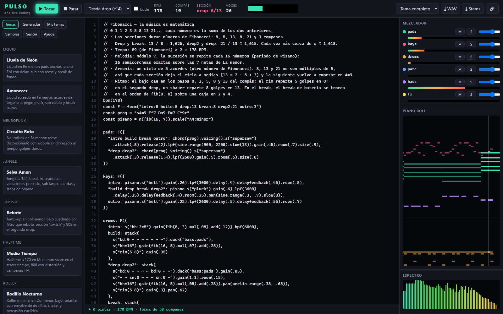

<h1 align="center">PULSO</h1>

<p align="center">
  <b>La música es código. El código es matemática.</b><br>
  Un estudio de Drum &amp; Bass donde cada tema es un programa que suena en vivo en tu navegador.
</p>

<p align="center">
  <a href="https://juancamp7777.github.io/STtic-DnB/#tema=fibonacci"><b>▶ Escucha «Fibonacci» en tu navegador</b></a>
  &nbsp;·&nbsp;
  <a href="https://juancamp7777.github.io/STtic-DnB/">Abrir el estudio</a>
  &nbsp;·&nbsp;
  <a href="https://juancamp7777.github.io/STtic-DnB/test/audio.html">Ver los tests de audio en vivo</a>
</p>



En Pulso un tema no se graba: **se escribe**. Cada golpe, cada nota y cada filtro es una expresión que se
evalúa mientras suena. Cambias una línea, pulsas `Ctrl+Enter` y la música cambia sin pararse. Nada de samples
descargados ni instaladores: la batería, los bajos y los efectos se sintetizan en tu navegador.

## La música es matemática

El tema **Fibonacci** está hecho con la sucesión 0 1 1 2 3 5 8 13 21…, donde cada número es la suma de los dos
anteriores:

```js
// Fibonacci, versión resumida (el tema completo está en tracks/fibonacci.js)
bpm(178)                                                            // 89 × 2: 89 es un número de Fibonacci
const F = form("intro:8 build:5 drop:13 break:8 drop2:21 outro:3")  // secciones de Fibonacci
const prog = "<Am9 F^7 Dm9 Em7 C^9>"                                // un ciclo de 5 acordes
const pisano = n(fib(16, 7)).scale("A4:minor")                      // 0 1 1 2 3 5 1 6 0 6 6 5 4 2 6 1

pads: F({ "intro build drop break drop2 outro": chord(prog).voicing().s("supersaw").lpf(2200).gain(.45).room(.7) })
keys: pisano.s("pluck").gain(.6).delay(.35)
drums: F({
  "drop drop2": s("bd:0 ~ ~ ~ ~ bd:0 ~ ~, ~ ~ sn:0 ~ ~ ~ sn:0 ~, hh*16, rim(5,8)").gain(.8),
  break: s("brk:1").splice(8, fib(8, 8))                            // el break, troceado en orden de Fibonacci
})
bass: F({ "drop drop2": chord(prog).rootNotes("e1").beat("0,3,5,8,13", 16).s("sub") })
```

- **El periodo de Pisano.** Si te quedas sólo con el resto de dividir entre 7, la sucesión de Fibonacci se repite
  exactamente cada 16 números. Una escala tiene 7 notas y un compás tiene 16 semicorcheas: `fib(16, 7)` es una
  melodía que encaja sola, compás tras compás.
- **La proporción áurea.** El drop dura 13 compases y el break 8: 13 / 8 = 1,625, y 21 / 13 ≈ 1,615. Cuanto más
  avanzas en la sucesión, más se acerca la división de dos números seguidos a φ ≈ 1,618, la proporción que
  aparece en las espirales de un girasol (que suelen ser 34 y 55).
- **Ritmos euclídeos.** `"rim(5,8)"` reparte 5 golpes en 8 pasos lo más parejo posible con el algoritmo de
  Bjorklund, el mismo que se diseñó para el sistema de temporización de un acelerador de partículas (la fuente
  de neutrones SNS). Así salen los ritmos tradicionales: (3,8) es el tresillo y (5,8) el cinquillo.
- **El bajo cae en los números de Fibonacci.** `.beat("0,3,5,8,13", 16)`: los pasos 0, 3, 5, 8 y 13 de cada
  compás forman un bajo sincopado de drum & bass.
- **Tiempo exacto.** Cada evento vive en fracciones (1/3, 5/8, 7/16…), nunca en decimales que se redondean:
  un patrón de 7 contra uno de 16 vuelve a cuadrar siempre, aunque suene una hora.
- **Azar reproducible.** `degradeBy`, `sometimes` o `rand` son deterministas: el mismo código suena igual en
  cualquier ordenador, y el generador de temas usa una semilla para que cada tema se pueda repetir.

## Qué trae

- **Un lenguaje de patrones compatible con Strudel**: mini-notación (`"bd*2 [~ sn] <a b>"`, euclídeos,
  polimetría, rangos), notas, escalas, acordes con voicings, arpegios, señales (`sine`, `perlin`…) y
  transformaciones (`every`, `sometimes`, `off`, `jux`, `chop`, `splice`, `chunk`, `pick`…). Puedes pegar
  código de [Strudel](https://strudel.cc) y casi todo el lenguaje funciona igual. Lo que no viene incluido son
  sus bancos de sonidos de internet (`piano`, `casio`, los `gm_…`): Pulso trae los suyos, sintetizados, y puedes
  cargar `dirt-samples` u otros desde la pestaña **Samples**.
- **Un motor de audio propio**: synths (`sub`, `reese`, `supersaw`, `b808`, `fm`, `bell`, `pluck`, `organ`…),
  batería y breaks de jungle **sintetizados** (funciona sin internet), risers, impacts y vinilo, filtros con
  envolvente, wobble sincronizado al tempo, vocales, distorsión, reverb, delay, **sidechain entre pistas** y un
  master con limitador que nunca satura.
- **Temas completos** con `form("intro:8 build:8 drop:16 break:8 drop2:16 outro:8")`: cada pista dice qué toca
  en cada sección.
- **Un estudio web**: editor, mezclador (mute, solo, volumen y medidor por pista), piano roll, espectro,
  biblioteca de temas, **generador de temas** por estilo y semilla, tocar desde una sección y en bucle,
  exportar **WAV** y **stems**, tus propios samples, salida **MIDI** y enlaces para compartir.
- **Composición en vivo con Claude**: con el estudio en local y [Claude Code](https://claude.com/claude-code)
  abierto en la carpeta del proyecto, enlaza la pestaña **Sesión** y Claude edita el tema contigo mientras suena.
- **Sin dependencias**: sólo Node ≥ 20 para el servidor local y un navegador. Ni siquiera hace falta `npm install`.

## Empezar

**En el navegador**, sin instalar nada: abre [el estudio](https://juancamp7777.github.io/STtic-DnB/), elige un
tema y pulsa **▶ Tocar**. La versión web lo tiene todo menos la sesión con Claude y guardar temas en la
biblioteca, que necesitan el servidor local.

**En tu ordenador**:

```bash
git clone https://github.com/juancamp7777/STtic-DnB.git
```

```bash
cd STtic-DnB
```

```bash
npm start
```

Después abre http://localhost:5173 en Chrome, Edge o Firefox.

## Tu primer tema

```js
bpm(174)
kick: s("bd ~ ~ ~ ~ bd ~ ~").duck("bass:pads")
snare: s("~ ~ sn ~ ~ ~ sn ~")
hats: s("hh*16").gain("[.3 .6]*8")
bass: note("<d1 f1 a1 c2>").s("sub").struct("x ~ ~ x ~ ~ x ~")
pads: chord("<Dm9 Bb^7 Gm9 A7sus4>").voicing().s("supersaw").lpf(1800).room(.6)
```

Pégalo en el editor y pulsa `Ctrl+Enter`. Cada línea con nombre es una pista del mezclador; el kick hace
sidechain al bajo y a los pads. Cambia `"hh*16"` por `"hh(7,16)"`, vuelve a pulsar `Ctrl+Enter` y escucha el
cambio sin cortes. La pestaña **Ayuda** del estudio tiene la chuleta completa.

## La biblioteca

Cada enlace abre el estudio con ese tema listo para tocar.

| Tema | Estilo | BPM | La idea |
| --- | --- | --- | --- |
| [Fibonacci](https://juancamp7777.github.io/STtic-DnB/#tema=fibonacci) | Atmospheric | 178 | Secciones de Fibonacci, 89 × 2 BPM y una melodía hecha con la sucesión módulo 7 |
| [Lluvia de Neón](https://juancamp7777.github.io/STtic-DnB/#tema=lluvia-de-neon) | Liquid | 174 | Re menor: pads anchos, piano FM con delay, sub con reese y break de fondo |
| [Circuito Roto](https://juancamp7777.github.io/STtic-DnB/#tema=circuito-roto) | Neurofunk | 172 | Fa menor: reese distorsionado con wobble sincronizado al tempo |
| [Selva Amen](https://juancamp7777.github.io/STtic-DnB/#tema=selva-amen) | Jungle | 165 | Break troceado con variaciones por ciclo, sub largo, cuerdas y órgano |
| [Rebote](https://juancamp7777.github.io/STtic-DnB/#tema=rebote) | Jump-up | 175 | Sol menor: bajo cuadrado con filtro que rebota y 808 en el segundo drop |
| [Medio Tiempo](https://juancamp7777.github.io/STtic-DnB/#tema=medio-tiempo) | Halftime | 170 | Mi menor: snare en el tercer tiempo, 808 con distorsión y campanas FM |
| [Rodillo Nocturno](https://juancamp7777.github.io/STtic-DnB/#tema=rodillo-nocturno) | Roller | 174 | Do menor: bajo rodante con envolvente de filtro y percusión euclídea |
| [Horizonte](https://juancamp7777.github.io/STtic-DnB/#tema=horizonte) | Atmospheric | 172 | Mi bemol mayor: pads muy largos, arpegios de campana, ride y vinilo |
| [Fiesta Reese](https://juancamp7777.github.io/STtic-DnB/#tema=fiesta-reese) | Dancefloor | 174 | Mi menor: riff de supersaw, reese gordo, palmas y crash |
| [Sombras](https://juancamp7777.github.io/STtic-DnB/#tema=sombras) | Dark | 172 | Si bemol menor: plucks euclídeos, kicks saturados y bajo FM metálico |
| [Amanecer](https://juancamp7777.github.io/STtic-DnB/#tema=amanecer) | Liquid | 176 | Fa mayor: acordes de órgano, arpegio pluck, sub cálido y break suave |

Y el **generador** crea temas nuevos de 7 estilos: cada semilla es un tema distinto, y la misma semilla da
siempre el mismo.

## Componer con Claude

Pulso está pensado para componer con una IA al lado. Hace falta el estudio en local y
[Claude Code](https://claude.com/claude-code) (en la terminal o en la app de escritorio de Claude), que trabaja
con los archivos de tu ordenador:

1. Arranca el estudio en local (`npm start`) y activa **Sesión → Enlazar con live/sesion.js**.
2. Abre Claude Code en la carpeta del proyecto y pídele lo que quieras: «haz el drop más oscuro», «añade un
   break de jungle», «compón un tema nuevo conmigo». Al empezar lee [CLAUDE.md](CLAUDE.md), así que ya sabe cómo
   funciona Pulso.
3. Lo que tocas se guarda en `live/sesion.js` y el estado (pistas, sección, bucle, avisos) en `live/estado.json`.
4. Claude edita `live/sesion.js` y el estudio lo recarga **en vivo, sin parar la música**. Si tienes cambios sin
   tocar, te pregunta antes de cargar nada.
5. Claude también puede "escuchar" la mezcla: `tools/render.html` mide el nivel, los graves y los agudos de cada
   sección y la aportación de cada pista.

El propio proyecto se construyó así, con [Claude](https://claude.ai) (Anthropic) como coautor.

## Herramientas

```bash
node tools/pulso.js check
```

Valida todos los temas: errores, avisos de mezcla, rangos de notas, sidechain a pistas que no existen…

```bash
node tools/pulso.js info fibonacci
```

Qué suena en cada sección, voces, rangos y sonidos de cada pista.

```bash
node tools/pulso.js new neuro 777
```

Genera un tema de neurofunk con la semilla 777 y lo añade a la biblioteca.

```bash
node tools/pulso.js save live/sesion.js mi-tema liquid "Mi tema"
```

Guarda tu sesión como tema. Nunca guarda un tema con errores; si sólo tiene avisos, añade `--force`, y para
sustituir uno que ya existe, `--overwrite`.

- `tools/render.html` → análisis de mezcla por sección y por pista.
- `strudel/` → el Strudel original, para comparar.

## Probado a fondo

```bash
npm test
```

- **184 tests en Node**: patrones (también con árboles aleatorios y consultas partidas en trozos, que deben dar
  exactamente lo mismo), mini-notación con fuzzing, teoría musical, evaluador, scheduler, el servidor real, la
  biblioteca, cada tema (cero errores y cero avisos) y 7 estilos × 80 semillas del generador.
- **109 tests de audio en el navegador** (`/test/audio.html`), en verde en Chrome, Edge y Firefox: cada synth y
  cada sonido del kit renderizados sin conexión, sidechain, grupos de corte, export WAV y stems, y cada tema de la
  biblioteca.
- Varias revisiones adversariales con agentes de IA: cada fallo confirmado tiene su test de regresión.

## Cómo está hecho

```
src/core/    motor de patrones: tiempo racional exacto, mini-notación, teoría musical, evaluador, scheduler
src/audio/   motor de audio Web Audio: voces, mezclador, sidechain, kit sintetizado, samples, WAV
src/gen/     generador de temas por estilo y semilla
src/tools/   analizador e índice de la biblioteca (lo usan la CLI, el servidor y los tests)
src/ui/      el estudio
tracks/      la biblioteca de temas (cada uno es código)
live/        la sesión compartida con Claude
tools/       CLI y análisis de mezcla
test/        tests de Node y de audio
server.js    servidor local: archivos, sesión en vivo y biblioteca (sólo escucha en tu ordenador)
```

## Créditos y licencia

Pulso es una implementación propia, inspirada en [Strudel](https://strudel.cc) y
[TidalCycles](https://tidalcycles.org), cuyo lenguaje de patrones respeta.

[MIT](LICENSE) © 2026 juancamp7777
